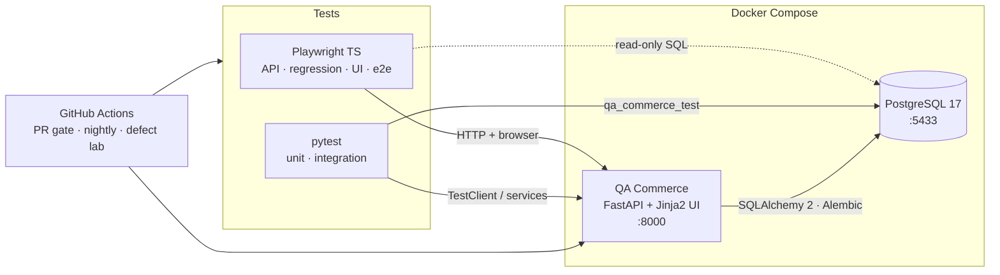
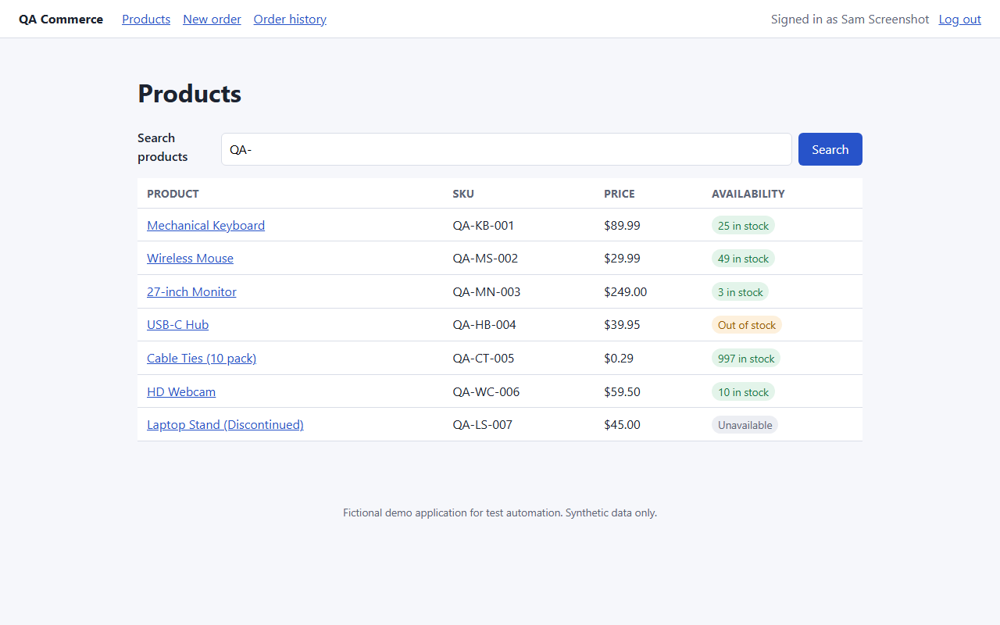
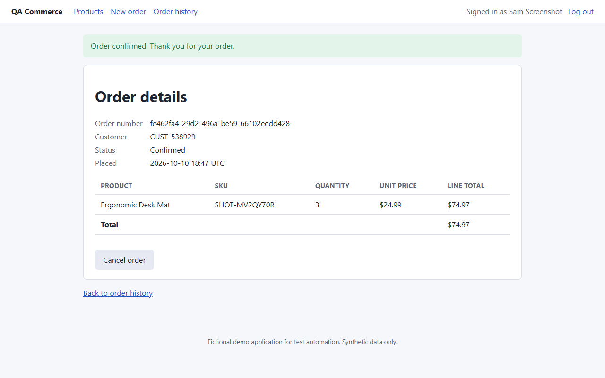
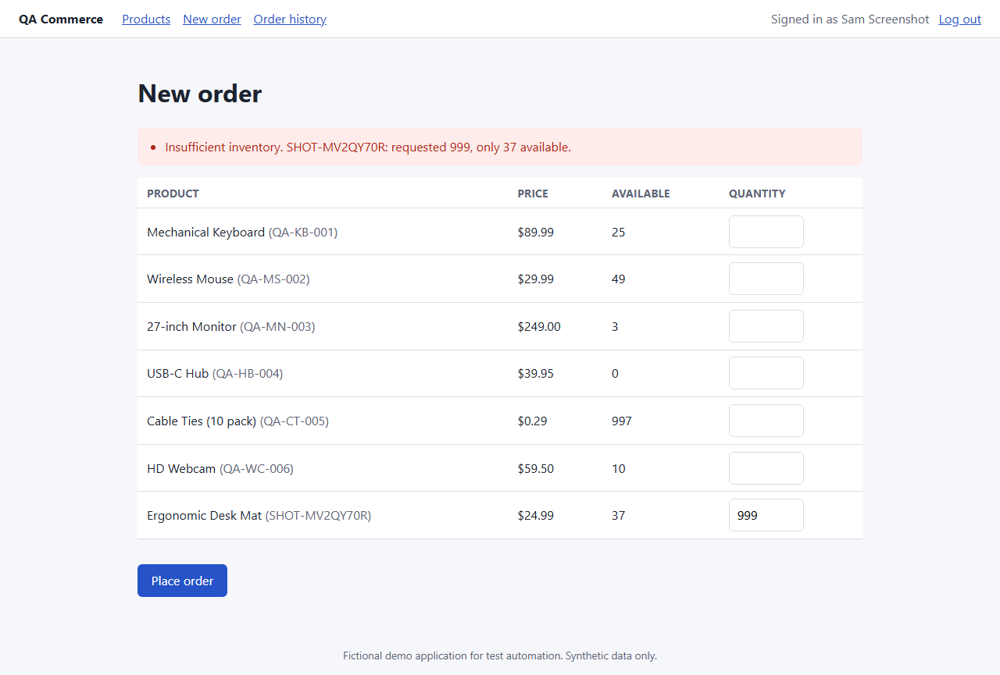
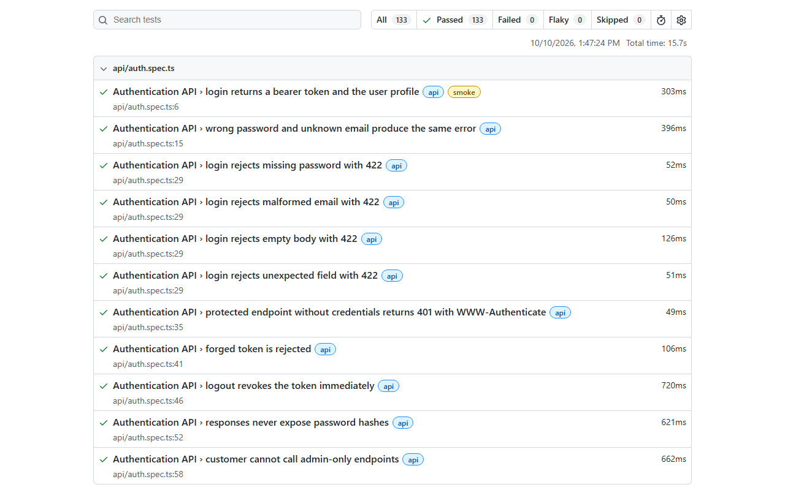
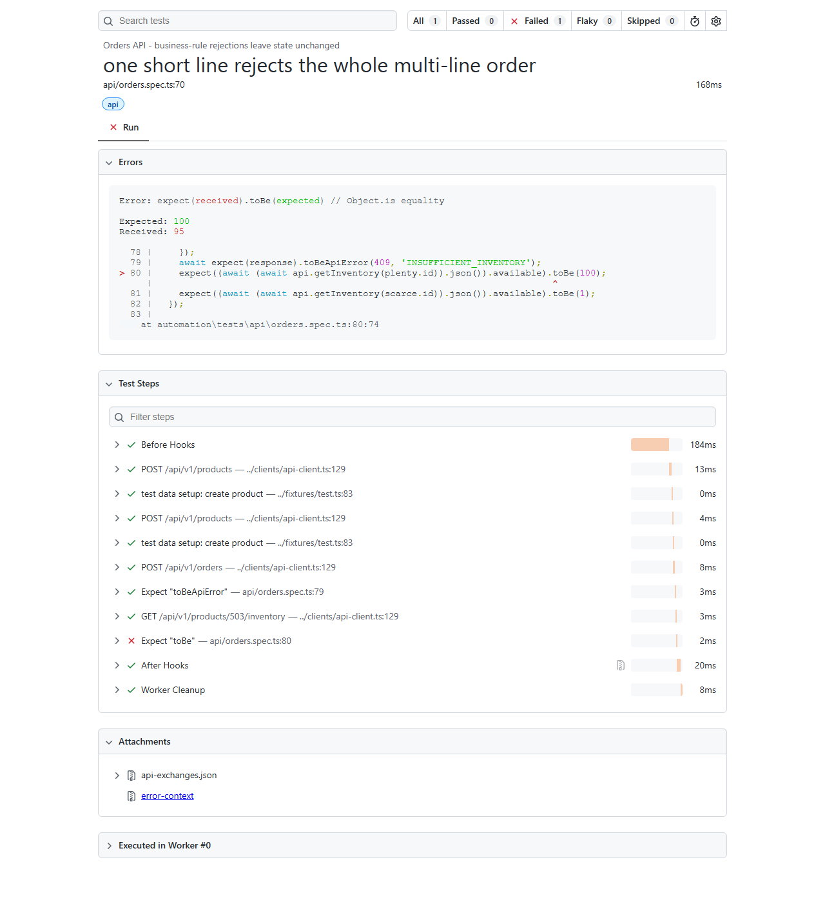

# QA Engineering Lab: QA Commerce

A self-contained test-automation laboratory: a small order-management application (**QA Commerce**)
that I own end to end, plus the infrastructure a production team would use to test it. That covers
backend unit and integration tests, Playwright API, UI and end-to-end suites, contract validation,
database verification, concurrency and failure-injection tests, CI pipelines, and a **defect lab**
that proves the suites catch real bugs.

> QA Commerce is a fictional test target, not a commerce platform. All data is synthetic, and every
> credential is a local-only placeholder.

<!-- CI badges: after pushing to GitHub, replace OWNER/REPO and uncomment.
[](https://github.com/OWNER/REPO/actions/workflows/pull-request.yml)
[](https://github.com/OWNER/REPO/actions/workflows/nightly-regression.yml)
-->

## Contents

[What it demonstrates](#what-it-demonstrates) · [Architecture](#architecture) · [Tech stack](#tech-stack) ·
[Quick start](#quick-start-windows-11--powershell) · [Running tests](#running-tests) ·
[Test coverage](#test-coverage-by-category) · [Reports](#reports-and-diagnostics) ·
[Defect lab](#defect-lab) · [CI/CD](#cicd) · [Design decisions](#design-decisions-and-trade-offs) ·
[Limitations](#known-limitations) · [Docs](#documentation)

## What it demonstrates

| Area | Where |
|---|---|
| REST API automation with schema and contract validation | `automation/tests/api`, `automation/schemas` (JSON Schema 2020-12, Ajv) |
| UI automation with role/label selectors and Page Objects | `automation/tests/ui`, `automation/pages` |
| Cross-channel e2e workflows (API → UI → DB and UI → API → DB) | `automation/tests/e2e` |
| Database validation, white-box and black-box | `backend-tests/integration`, `automation/utils/db.ts` (read-only) |
| Boundary, negative and decimal-currency regression | `automation/tests/regression/boundaries.spec.ts` |
| Atomicity proven by fault injection mid-transaction | `app/faults.py`, `regression/atomicity.spec.ts` |
| Concurrency: last unit, oversell, double-submit races | `regression/concurrency.spec.ts`, `TestConcurrency` |
| Idempotency (sequential, concurrent, browser form replay) | `regression/idempotency.spec.ts`, `e2e/ui-to-api.spec.ts` |
| Test data isolation for fully parallel runs | `automation/fixtures/test.ts`, `automation/data` |
| Failure diagnostics without leaking secrets | redacted `api-exchanges.json`, traces, screenshots, video |
| Defect reproduction and regression verification | `app/defects.py`, `scripts/defect_lab.py` |
| CI with reports and artifacts; nightly cross-browser and flakiness detection | `.github/workflows` |

## Architecture



One FastAPI process serves the REST API (`/api/v1`) and a server-rendered UI. Both use the same
service layer, so a business rule exists exactly once. Details: [docs/architecture.md](docs/architecture.md).

## Tech stack

| Layer | Technology |
|---|---|
| Application | Python 3.12 (Docker/CI; 3.13 also verified locally), FastAPI 0.143, Pydantic 2.14, SQLAlchemy 2.1, Alembic 1.20, Jinja2, argon2 |
| Database | PostgreSQL 17.9 |
| Backend tests | pytest 9, FastAPI TestClient, pytest-cov |
| Automation | Playwright 1.64 (`@playwright/test`), TypeScript 6.0, Ajv 8 + ajv-formats, node-postgres |
| Quality | ruff (lint and format), ESLint 10 + typescript-eslint, Prettier, `tsc --noEmit` |
| Infrastructure | Docker, Docker Compose, GitHub Actions |

TypeScript is pinned to 6.0 rather than 7.x because typescript-eslint 8.71 supports `<6.1`. See
[Updating dependencies](#updating-dependencies).

## Application features

- **Auth:** login and logout with revocable server-side sessions (only token hashes are stored),
  argon2 password hashing, admin and customer roles, consistent 401 and 403 handling.
- **Catalogue:** list, search and filter (name, SKU, description, active, in-stock, price range),
  product detail, inventory endpoint, and admin create, update and set-inventory with strict validation.
- **Orders:** multi-line orders with server-side `Decimal` pricing, row-locked inventory decrement,
  `Idempotency-Key` support, paginated history, cancellation that restores stock.
- **Web UI:** login, product list and detail, multi-product order form, confirmation, history with
  pagination, cancellation, validation messages, CSRF protection, open-redirect protection.
- **Ops:** liveness `/api/v1/health/live`, readiness `/api/v1/health` (503 when the DB is down),
  `X-Request-ID` correlation, OpenAPI at `/docs`.

The full contract with error codes and business rules is in [docs/api-contract.md](docs/api-contract.md).

| Products | Order confirmation | Validation message |
|---|---|---|
|  |  |  |

## Quick start (Windows 11 + PowerShell)

### Prerequisites

- Git, **Docker Desktop** (WSL 2 backend), **Python 3.12 or 3.13**, **Node.js 22+** (24 LTS used in CI)
- VS Code is recommended but not required

### 1. Configure

```powershell
git clone <your-fork-url> qa-engineering-lab
cd qa-engineering-lab
Copy-Item .env.example .env      # local-only placeholder values; edit if ports clash
```

### 2. Start the environment

```powershell
docker compose up --build -d     # PostgreSQL (with health check) + the app
.\scripts\wait-for-health.ps1    # polls /api/v1/health until ready
```

- Web UI: **http://localhost:8000**. Sign in as `customer@qa-commerce.test` / `Customer#Local2024`.
- API docs: **http://localhost:8000/docs** (OpenAPI JSON at `/openapi.json`)
- Admin (for API use): `admin@qa-commerce.test` / `Admin#Local2024`

On start the app container applies migrations and seeds deterministic data ([docs/test-data.md](docs/test-data.md)).

<details>
<summary><b>No Docker? Docker-free fallback</b></summary>

`scripts/local-postgres.ps1` downloads the official PostgreSQL 17.9 Windows binaries into the
git-ignored `.local\` folder and serves them on the **same port, user and database names** as the
Compose service, so the same `.env` works. Nothing is installed system-wide.

```powershell
.\scripts\local-postgres.ps1 start   # first run downloads ~330 MB
py -3.13 -m venv .venv; .\.venv\Scripts\python.exe -m pip install -r requirements-dev.txt
.\scripts\local-app.ps1 start        # migrations + seed + uvicorn on :8000, waits for readiness
# ...
.\scripts\local-app.ps1 stop; .\scripts\local-postgres.ps1 stop
```
</details>

### 3. Install the test tooling

```powershell
py -3.12 -m venv .venv                       # or -3.13
.\.venv\Scripts\python.exe -m pip install -r requirements-dev.txt
cd automation
npm ci
npx playwright install chromium              # add "firefox webkit" for the nightly set
cd ..
```

### 4. Stop

```powershell
docker compose down              # keeps the database volume
docker compose down --volumes    # also deletes this project's database volume (clean reset)
```

## Running tests

The app must be running for the integration and Playwright suites. Unit tests need nothing.

| Suite | Command (from repo root unless noted) |
|---|---|
| **Everything the PR gate runs** | `.\scripts\test-all.ps1` |
| Backend unit | `.\.venv\Scripts\python.exe -m pytest backend-tests/unit` |
| Backend integration | `.\.venv\Scripts\python.exe -m pytest backend-tests/integration` |
| Playwright PR set (API + regression + Chromium UI/e2e) | `cd automation; npm test` |
| API only | `cd automation; npm run test:api` |
| Regression only | `cd automation; npm run test:regression` |
| UI only (Chromium) | `cd automation; npm run test:ui` |
| End-to-end only | `cd automation; npm run test:e2e` |
| Smoke | `cd automation; npm run test:smoke` |
| Nightly set (adds Firefox + WebKit) | `cd automation; npm run test:nightly` |
| One test, headed/debug | `cd automation; npx playwright test tests/ui/orders.spec.ts -g "confirmation" --headed` |
| Defect lab | `.\.venv\Scripts\python.exe scripts\defect_lab.py --all --with-control` |
| Lint and type checks | `.\.venv\Scripts\python.exe -m ruff check .` · `cd automation; npm run lint; npm run typecheck` |

**Resetting data safely**

- `.\scripts\reset-test-db.ps1` resets the backend test database. It refuses any database whose name doesn't end in `_test`.
- Playwright suites don't need a reset: every test creates its own uniquely named data.
- To reset the development database: `docker compose down --volumes` (only this Compose project's volume).

## Test coverage by category

Counts come from `pytest --collect-only` and `playwright test --list` on the current code.

| Category | Tests | Files | Highlights |
|---|---:|---:|---|
| Backend unit | 105 | 4 | Decimal pricing, rule precedence, strict schemas, error envelope, CSRF, open redirects, production guards |
| Backend integration | 76 | 3 | Persistence, rollback via fault injection, DB constraints, threaded race tests, idempotency, auth/session expiry |
| Playwright API | 62 | 4 | Contract and schema checks, auth failures, validation (11 malformed-body cases), state after every rejection |
| Playwright regression | 43 | 4 | Boundaries, 6 decimal cases, idempotency, atomicity (API **and** DB), HTTP-level concurrency |
| Playwright UI | 26 per browser | 3 | Login and logout, redirects, catalogue, ordering, validation messages, history pagination, cancellation |
| Playwright e2e | 3 per browser | 2 | API→UI→DB with cancellation; UI→API→DB; form re-submission replay |

The PR gate runs 181 backend tests and 134 Playwright tests (UI and e2e on Chromium). The nightly
run adds Firefox and WebKit (192 Playwright tests in total), repeats the concurrency tests 10×, and
runs the defect lab. In the most recent local run of each suite, all of these passed, including all
three browsers.

## Reports and diagnostics

| Output | Location |
|---|---|
| Playwright HTML report | `automation/playwright-report/` · open with `cd automation; npx playwright show-report` |
| Playwright JUnit / JSON | `automation/test-results/junit.xml`, `results.json` |
| Traces, screenshots, video (failed browser tests) | `automation/test-results/artifacts/<test>/` · `npx playwright show-trace <path>\trace.zip` |
| Redacted HTTP log (every failed test) | `api-exchanges.json` attachment in the HTML report |
| Backend JUnit (from `test-all.ps1` / CI) | `reports/backend-*.xml` |
| CI | Artifacts `playwright-report`, `test-results-and-logs` (includes container logs), `nightly-reports`, `defect-lab-reports` |

Passwords, bearer tokens, cookies and CSRF tokens are replaced with `[REDACTED]` in attachments.
Traces are disabled for API projects because Playwright traces record raw `Authorization` headers.
How to investigate a failure step by step: [docs/troubleshooting.md](docs/troubleshooting.md#investigating-a-failed-test).

| Passing run (HTML report) | Defect caught, with redacted HTTP log attached |
|---|---|
|  |  |

## Defect lab

Four realistic defects live in `app/defects.py`. They're activated only by `DEFECT_MODE` and
refused in production. The runner starts a separate defect-mode instance on port 8001, requires the
targeted tests to **pass** on the correct code (control run) and **fail** with the defect.

| Defect | Business impact | Caught by |
|---|---|---|
| `wrong_total`: float arithmetic, truncated to cents | 0.29 × 3 billed as 0.86 | Decimal regression cases; integration total check |
| `inventory_before_validation`: stock committed before full validation | Phantom stock loss on rejected orders | "one short line rejects the whole order"; rollback tests |
| `persist_rejected_order`: order row committed first | Phantom empty orders in history | Every negative test also asserts order count; atomicity DB probe |
| `oversell_race`: no row locks (lost update) | Last unit sold many times | HTTP and thread concurrency tests |

Latest local run of `scripts/defect_lab.py --all --with-control`: **4/4 defects detected by both
the backend and the Playwright suites; all control runs passed.** Reproduction steps, the exact
detecting tests and expected behaviour are in [docs/defect-lab.md](docs/defect-lab.md).

## CI/CD

| Workflow | Trigger | What it does |
|---|---|---|
| [`pull-request.yml`](.github/workflows/pull-request.yml) | PRs, pushes to `main`, manual | **Job 1:** ruff, ESLint, Prettier, `tsc`, backend unit tests. **Job 2:** `docker compose up --wait`, readiness check, backend integration, Playwright PR set, JUnit job summary, artifacts (uploaded even on failure), teardown. |
| [`nightly-regression.yml`](.github/workflows/nightly-regression.yml) | 03:00 UTC daily, manual (configurable repeat count) | Full backend suite with coverage, every Playwright project including Firefox and WebKit, concurrency tests repeated N×, defect lab job; artifacts; teardown |

No secrets are required; every value is a public local-only placeholder. **Retries are 0**: a test
that only passes on retry is reported as a failure, never hidden.

## Design decisions and trade-offs

- **A monolith with a server-rendered UI** keeps the system understandable for one person and
  gives Playwright stable, semantic HTML. The trade-off is that there's no SPA-specific behaviour to test.
- **One service layer for API and UI** means rules can't drift between channels, and both suites
  exercise the same code.
- **Pessimistic locking** (`SELECT … FOR UPDATE` in id order) makes overselling provably impossible
  and is easy to test. It serialises orders per product, which is acceptable at this scale.
- **Idempotency keys stored on the order under a unique constraint** let the database settle races
  without a separate key store. Keys never expire (documented).
- **Black-box suites create their own data via the API** instead of resetting the shared database.
  That keeps them parallel-safe and runnable against any environment. White-box integration tests
  reset a dedicated `_test` database before every test for exact assertions.
- **Hand-written consumer-side JSON Schemas** rather than generated ones: they fail when the server
  changes what clients depend on, even if the server's own OpenAPI document changed along with it.
- **Defects injected by function replacement in one module** keep the correct code free of
  `if bug:` branches, and the CI job proves every defect stays detectable.

## Known limitations

- **Verification status:** the Docker Compose stack has been verified locally on Windows 11 with
  Docker Desktop (WSL 2). `docker compose up --build -d` brings up PostgreSQL and the app, and
  `.\scripts\test-all.ps1` (lint, backend unit and integration, Playwright) passes against it. The
  defect lab (`scripts/defect_lab.py --all --with-control`) detects every defect using the Compose
  database. The Docker-free path was verified earlier. The GitHub Actions workflows validate against
  the GitHub workflow schema but have not yet run on GitHub, so the first CI run will confirm them.
- Python 3.13 was used locally; Docker and CI use Python 3.12.
- No products can be deleted (they're retired instead), there's no self-registration, no login rate
  limiting, and no tax, shipping or fulfilment workflow.
- Playwright runs leave retired test products and test customers in the development database (reset with `docker compose down --volumes`).
- Browser traces may contain synthetic test credentials and session cookies (local-only by design).
- `starlette.testclient` emits a deprecation warning recommending `httpx2`. `httpx` is kept for now.

## Future improvements

- Run the PR suite against the built image in a Compose `test` profile with an isolated database per run.
- Accessibility checks with `@axe-core/playwright`; visual comparisons for key pages.
- Load and soak tests (k6 or Locust) for the order endpoint, with locking metrics.
- Contract tests generated from `/openapi.json` alongside the consumer schemas (e.g. Schemathesis).
- Mutation testing (mutmut) for `rules.py` to complement the hand-built defect lab.
- Test-impact analysis in CI, and sharding when the suite grows.

## Updating dependencies

1. Python: edit the pins in `requirements.txt` / `requirements-dev.txt`, `pip install -r requirements-dev.txt`, run `.\scripts\test-all.ps1`.
2. Automation: `cd automation; npm outdated`. Check peer ranges (e.g. `npm view typescript-eslint peerDependencies`) before bumping TypeScript or ESLint. Then `npm install <pkg>@<version>`, `npx playwright install`, and run the suites.
3. Images and actions: bump `postgres:17.x-alpine` / `python:3.12-slim-bookworm` and the `actions/*@vN` majors together, then let CI verify.

## Repository layout

```
app/                 FastAPI app: api/, web/, services/, models/, schemas/, templates/, static/, db/
migrations/          Alembic migrations
backend-tests/       pytest: unit/ and integration/
automation/          Playwright: tests/{api,regression,ui,e2e}, pages/, fixtures/, clients/, schemas/, data/, utils/
docs/                architecture, test strategy, API contract, test data, defect lab, troubleshooting
scripts/             PowerShell helpers, CI helpers, defect-lab runner
.github/workflows/   pull-request.yml, nightly-regression.yml
```

## Documentation

- [Architecture](docs/architecture.md): components, decisions, topology
- [Test strategy](docs/test-strategy.md): scope, risks, levels, flakiness and secrets policy
- [API contract](docs/api-contract.md): endpoints, schemas, error codes, business rules
- [Test data](docs/test-data.md): seed data, isolation, cleanup, setup techniques
- [Defect lab](docs/defect-lab.md): defects, impact, detection, reproduction
- [Troubleshooting](docs/troubleshooting.md): common failures, investigating a failed test
