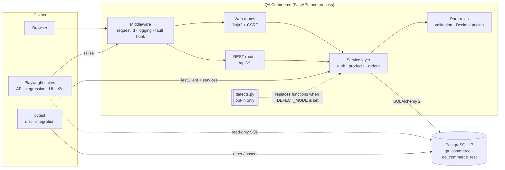

# Architecture

QA Commerce is deliberately a **single deployable** (one FastAPI process plus PostgreSQL). The test
infrastructure around it is where the engineering effort goes.

## Component responsibilities

| Component | Location | Responsibility |
|---|---|---|
| Configuration | `app/config.py` | Typed settings from environment and `.env`. Refuses the placeholder secret or `DEFECT_MODE` in production. |
| Middleware | `app/main.py` | Request id (generated or echoed), access log with no headers or bodies, activation of the opt-in fault hook |
| Error handling | `app/errors.py` | Domain exceptions mapped to one JSON error envelope. 500s never leak internals. |
| REST API | `app/api/` | HTTP concerns only: parsing, status codes, headers (`Location`, `Idempotent-Replayed`) |
| Web UI | `app/web/`, `app/templates/` | Server-rendered pages calling the **same services** as the API, so rules cannot drift. Session cookie, CSRF tokens, open-redirect protection. |
| Services | `app/services/` | Transactions, row locking, idempotency, authorisation decisions |
| Rules | `app/services/rules.py` | Pure functions: validation order, `Decimal` money arithmetic. No I/O, so they're fully unit-testable. |
| Persistence | `app/models/`, `migrations/` | SQLAlchemy models with DB-level `CHECK` / `UNIQUE` constraints; Alembic migrations |
| Seed and reset | `app/db/seed.py`, `app/db/reset.py` | Idempotent deterministic seed; reset that refuses non-`_test` databases |
| Fault hook | `app/faults.py` | `X-Test-Fault` raises at named points mid-transaction (only with `ENABLE_TEST_HOOKS`) |
| Defect lab | `app/defects.py`, `scripts/defect_lab.py` | Deliberately broken function replacements, loaded only with `DEFECT_MODE` |

## Key design decisions

| Decision | Why | Trade-off |
|---|---|---|
| Monolith, server-rendered UI | Small enough for one person; HTML is stable and accessible for Playwright. No SPA build. | No client-side interactivity to test |
| One service layer for API and UI | A business rule fixed once is fixed everywhere. UI tests and API tests check the same code. | The UI is not an API client, so there's no "UI calls API" path |
| Pessimistic row locks for orders | Simple to reason about and provably prevents overselling (see concurrency tests) | Serialises orders for the same product. Fine at this scale. |
| Idempotency key stored on the order with a unique constraint | The database settles concurrent duplicates, with no separate key table or TTL to manage | Keys never expire |
| Opaque tokens with server-side sessions | Logout really revokes; a DB leak exposes only SHA-256 hashes | One DB lookup per request |
| Money as `Decimal`, serialised as strings | No binary-float errors anywhere, including in clients | Clients must parse strings |
| Strict request schemas (`extra="forbid"`, strict ints) | Clients cannot supply totals; `"2"` and `2.0` are not silently coerced | Less forgiving for sloppy clients |
| Defects as runtime function replacement | The correct code has no `if bug:` branches; every defect sits in one reviewable file | Defects live alongside production code (they're inert unless enabled) |

## Runtime topology

| Mode | Database | Application | Used for |
|---|---|---|---|
| Docker Compose (default) | `db` service, `postgres:17.9-alpine`, host port 5433 | `app` service built from `Dockerfile`, port 8000 | Local development, CI |
| Docker-free fallback | Portable PostgreSQL 17.9 via `scripts/local-postgres.ps1`, port 5433 | `scripts/local-app.ps1` (virtualenv), port 8000 | Machines without Docker Desktop |
| Defect lab | Same database | Temporary process on port 8001 with `DEFECT_MODE` set | `scripts/defect_lab.py` |

Both PostgreSQL options publish the same port, user and database names, so one `.env` serves both.
The container image runs as a non-root user, applies migrations on start, seeds if
`SEED_ON_STARTUP=true`, and has a `HEALTHCHECK` on `/api/v1/health`.

## Databases

- `qa_commerce`: the application database (development, Playwright suites). Persistent volume `pgdata`.
- `qa_commerce_test`: owned by the backend integration suite and reset before every test.

Tables: `users`, `auth_sessions`, `products`, `orders`, `order_items`. Constraints enforced by the
database include `price > 0`, `inventory >= 0`, `quantity > 0`, `total >= 0`, the status and role
enums, unique SKU, e-mail and customer ref, unique `(order_id, product_id)`, and unique
`(user_id, idempotency_key)`.
